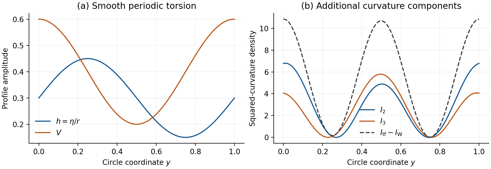

# 3. 円方向torsionと曲率成分

## 3.1 微分を含む厳密な分離

一定の $`M`$ では、一定の空間直交回転で構造行列を対角化できる。巡回的に $`\mathrm{d}e^i=n_i e^j\wedge e^k`$ と書き、 $`n_i`$ を定数とする。round球面、平坦トーラス、未変形Nilはそれぞれ $`(4/r,4/r,4/r)`$ 、 $`(0,0,0)`$ 、 $`(0,0,-1/r)`$ に対応する。 $`\dot f=D_3f=L^{-1}\mathrm{d}f/\mathrm{d}y`$ と定める。 $`\mathrm{d}K`$ を含む $`\mathrm{d}\omega+\omega\wedge\omega`$ から直接計算すると、次を得る。

式(D-01)。

$$
\begin{aligned}
W_{\mathrm{EC}}&=W_{\mathrm{LC}},\\
I_2&=6\left(\dot h+\frac23 hV\right)^2,\qquad
I_3=6\left(\dot h-\frac23 hV\right)^2,\\
I_{\mathrm{tf}}&=I_{\mathrm{LC}}+12\dot h^2+\frac{16}{3}h^2V^2,\\
R_{\mathrm{EC}}&=R_{\mathrm{LC}}-6h^2-\frac23V^2+2\dot V.
\end{aligned}
$$

これらは任意の定数 $`n_i`$ と二つの円方向profileの任意の一次jetに対して成り立つ恒等式である。一定の空間shapeを変えると $`R_{\mathrm{LC}}`$ と $`I_{\mathrm{LC}}`$ が変わり、表示したtorsion項は保たれる。付録Bに接続と射影後のテンソル成分を示す。ベクトルトレースの微分 $`\dot V`$ はスカラーに全微分として入り、Ricciトレース除去後の二乗不変量は $`\dot h`$ に依存する。

| torsion族 | LC比較値に対する追加成分 |
|---|---|
| AX： $`V=0`$ | $`I_2=I_3=6\dot h^2`$ 。非一定の軸性profileではRicciトレース除去モデルに微分二乗項がある。 |
| VT： $`h=0`$ | この固定幾何では $`V`$ が変化しても $`I_2=I_3=0`$ になる。 |
| MX | 局所的には $`I_2`$ と $`I_3`$ が異なり、等しい係数の和では混合微分項が打ち消し合う。 |

零微分極限では $`I_2=I_3=8h^2V^2/3`$ となり、Paper02へ戻る。純AXの円方向対照に現れる $`12\dot\eta^2/r^2`$ は、追加二成分がそれぞれ6ずつ担い、既約Weylからの寄与は零である。純AXの局所一次jetでは、補助対照として $`I_{\mathrm{tf}}-I_{\mathrm{LC}}=4\sum_{i=0}^2(D_i h)^2+12(D_3h)^2`$ も得られる。これは一点での方向別係数の比較であり、以下の作用ではtorsionを円方向にのみ変化させる。

round球面 $`r=2`$ 、 $`L=1`$ における滑らかな周期profileの例。 $`h=0.30+0.15\sin(2\pi y)`$ 、 $`V=0.40+0.20\cos(2\pi y)`$ を指定した。追加二成分は局所的に異なり、その和がRicciトレース除去モデルの補正となる。この例の $`I_{\mathrm W}=I_{\mathrm{LC}}`$ は零である。 $`h`$ と $`V`$ は指定したprofile（off-shell）である。

## 3.2 制限作用とEuler式

Ricciトレース除去モデルで $`\chi_X=1`$ 、LC-Weylと既約EC-Weylで $`\chi_X=0`$ とする。周期的な全微分を積分した後の厳密な円方向作用は次となる。

式(D-02)。

$$
\begin{aligned}
S_X=c_M Lr^3\int_0^1\mathrm{d}y\thinspace \bigg[
&-\frac{R_{\mathrm{LC}}}{2\kappa^2}-\alpha I_{\mathrm{LC}}
+\frac{3h^2}{\kappa^2}+\frac{V^2}{3\kappa^2}\\
&-\chi_X\alpha\left(12\dot h^2+\frac{16}{3}h^2V^2\right)\bigg].
\end{aligned}
$$

この族のLC比較作用と既約Weyl作用では、torsionのEuler式は代数的な $`h=V=0`$ となる。Ricciトレース除去モデルでは次の式になる。

式(D-03)。

$$
\begin{aligned}
24\alpha\ddot h+\left(\frac{6}{\kappa^2}-\frac{32\alpha}{3}V^2\right)h&=0,\\
\left(\frac{2}{3\kappa^2}-\frac{32\alpha}{3}h^2\right)V&=0.
\end{aligned}
$$

bulk密度の速度Hessianは $`h`$ 方向で $`-24\alpha`$ 、 $`V`$ 方向で零となる。 $`\alpha\ne0`$ では、非零背景でも $`h`$ の最高微分項が存在する。 $`V`$ の代数係数が零になる場合があり、それで割ると枝を失う。

この制限範囲では二つの帰結がある。 $`\alpha\le0`$ の場合、第一Euler式に $`h`$ を掛け、円上で部分積分すると非負項の和を得る。

式(D-04)。

$$
\int_0^1\mathrm{d}y\left[
\frac{6h^2}{\kappa^2}-\frac{32\alpha}{3}h^2V^2-24\alpha\dot h^2\right]=0.
$$

したがって $`\alpha\le0`$ では、固定幾何上の滑らかな周期的torsion停留profileは $`h=V=0`$ に限られる。一方 $`\alpha>0`$ では、一定の非零振幅 $`a`$ を使った $`h=a\cos(2\pi n y)`$ 、 $`V=0`$ の族について次を得る。

式(D-05)。

$$
\frac{S_{\mathrm{tf}}[h,0]-S_{\mathrm{tf}}[0,0]}{c_M Lr^3 a^2}
=\frac{3}{2\kappa^2}-\frac{24\pi^2\alpha n^2}{L^2}.
$$

整数周波数を増やすと負の無限大へ向かい、幾何を固定したまま微分による非有界方向が存在する。これはPaper02の静的有界性判定とは別の機構である。他二作用のこの制限されたtorsion部分には同じ方向はない。

## 3.3 局所密度と周期積分

式(D-06)。

$$
\begin{aligned}
\frac{T^a\wedge T_a}{\mathrm{vol}}&=-4Vh,\qquad
\frac{e^a\wedge e^b\wedge R_{ab}}{\mathrm{vol}}=-4Vh+6\dot h,\\
\mathcal N&=-6\dot h,\\
\mathcal P&=\frac{\sum_{a,b}R_{ab}\wedge R_{ab}}{\mathrm{vol}}
=D_3\left(2R_{\mathrm{LC}}h-4h^3-\frac43hV^2\right).
\end{aligned}
$$

曲率–coframe縮約の成分表示は $`\tfrac12\varepsilon^{abcd}R_{abcd}`$ である。局所的なNY・Pontryagin密度は非零になり得るが、一定幾何上のこの滑らかな周期profileでは両積分とも零になる。ここで $`\mathcal P`$ は曲率2形式の外積の形式添字を用いて定義しており、内部双対縮約 $`\varepsilon^{abcd}R_{abmn}R_{cd}{}^{mn}`$ とは異なるスカラーである。式(D-06)は境界流を明示し、局所的な曲率寄与と特性密度の積分を区別する。

## 3.4 周期停留枝と第二変分

**命題（正の結合）。** 物理円周長Lの連結な円上で、幾何を固定したRicciトレース除去作用の滑らかな実周期停留torsionは、正のαについて次の枝に限られる。ここで $`z=Ly`$ 、二つの符号は独立とし、調和波枝では $`a^2+b^2>0`$ とする。

式(D-07)。

$$
\begin{aligned}
H&=\frac1{4\kappa\sqrt\alpha},\qquad
\alpha_n=\frac{L^2}{16\pi^2\kappa^2 n^2},\quad n\ge1,\\
(h,V)&=(0,0)\quad\text{or}\quad(\pm H,\pm3H),\\
V&=0,\quad h=a\cos(2\pi nz/L)+b\sin(2\pi nz/L),
\quad\alpha=\alpha_n.
\end{aligned}
$$

**証明。** $`V\ne0`$ の開集合では式(D-03)の代数方程式から $`h^2=H^2`$ が従う。滑らかさにより各連結成分でhは一定となり、残るEuler式が $`\lvert V\rvert=3H`$ を強制する。連続性から境界点でVが零になることはできず、この開集合は閉でもある。円の連結性により全円または空集合となる。後者では $`V\equiv0`$ で、 $`\ddot h+h/(4\alpha\kappa^2)=0`$ の周期条件が式(D-07)の共鳴条件を与える。Vの係数で割ることなく、滑らかな枝の貼り合わせも除外できる。

停留profile $`(\bar h,\bar V)`$ の周りの摂動を $`(\phi,v)`$ とすると、bulk第二変分は次となる。

式(D-08)。

$$
\begin{aligned}
\delta^2\ell={}&\left(\frac6{\kappa^2}-\frac{32\alpha}{3}\bar V^2\right)\phi^2
+\left(\frac2{3\kappa^2}-\frac{32\alpha}{3}\bar h^2\right)v^2\\
&-\frac{128\alpha}{3}\bar h\bar V\phi v-24\alpha\dot\phi^2.
\end{aligned}
$$

零枝と調和波枝では、 $`v=0`$ に制限しても、一定の軸性摂動が正方向、十分高いFourier周波数の軸性摂動が負方向となる。共鳴時のsine・cosine軸性方向は零方向でもある。定数混合枝の各Fourier blockは次である。

式(D-09)。

$$
H_m=\begin{pmatrix}-24\alpha\xi_m^2&\pm4/\kappa^2\\
\pm4/\kappa^2&0\end{pmatrix},\qquad
\xi_m=\frac{2\pi m}{L},\qquad\det H_m=-\frac{16}{\kappa^4}.
$$

したがって正の結合での全停留枝は、この制限Euclidean汎関数のsaddleである。零torsionからの作用差は調和波枝で零、定数混合枝では4体積あたり $`3/(16\alpha\kappa^4)>0`$ となる。非正のαでは式(D-02)のtorsion項が非負の和となり、零torsionが唯一の最小点である。LC-Weylと既約EC-Weyl作用では、この固定metric族のtorsion最小点は全αで零に限られる。定数混合解そのものはPaper02の静的項の代数的帰結であり、本稿の拡張は周期解の完全性と第二変分の整理にある。
