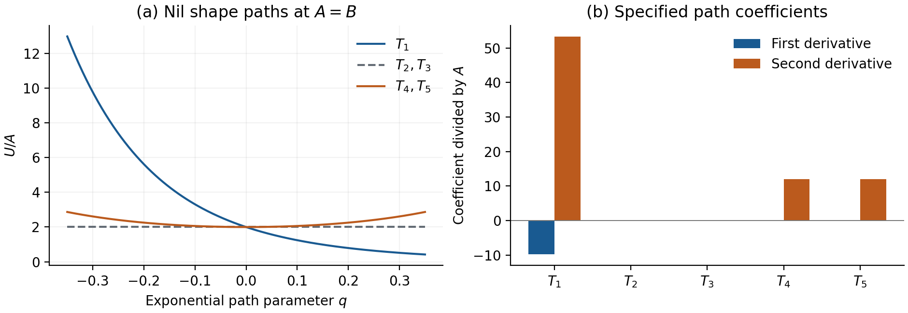

# 4. 静的な横断変形

## 4.1 独立で正規化されたshape方向

Frobenius内積で $`\mathrm{tr}(T_A T_B)=\delta_{AB}`$ を満たすtraceless対称基底を使い、一つの指数写像 $`M=\exp(\sum_Aq_AT_A)`$ でshapeを指定する。

式(H-01)。

$$
\begin{aligned}
T_1&=\frac{\mathrm{diag}(1,1,-2)}{\sqrt6},\qquad
T_2=\frac{\mathrm{diag}(1,-1,0)}{\sqrt2},\\
T_3&=\frac{E_{01}+E_{10}}{\sqrt2},\quad
T_4=\frac{E_{02}+E_{20}}{\sqrt2},\quad
T_5=\frac{E_{12}+E_{21}}{\sqrt2}.
\end{aligned}
$$

$`E_{ij}`$ は行列単位である。 $`r,L,\eta,V`$ を固定した整列静的torsionの寄与は、三モデルとも $`M`$ に依存しない。shape微分は $`-R_{\mathrm{LC}}/(2\kappa^2)-\alpha I_{\mathrm{LC}}`$ から生じる。任意の一定な単位行列式 $`M`$ について、空間構造行列は $`N=r^{-1}M N_0M^{\mathsf T}`$ と書ける。 $`N_0`$ は順に $`4I`$ 、零、 $`-E_{22}`$ である。この対称行列を第3節の $`n_i`$ へ対角化できるため、その恒等式は全5方向のshape変形にも成り立つ。

round球面では回転対称性により、この基底のHessianは単位行列に比例する。 $`M=\mathrm{diag}(t,t,t^{-2})`$ 、 $`t=\exp(q_1/\sqrt6)`$ とした一方向の計算から、 $`R_{\mathrm{LC}}''(0)=-64/r^2`$ 、 $`I_{\mathrm{LC}}''(0)=4096/r^4`$ を得る。したがって次が成り立つ。

式(H-02)。

$$
\left.\nabla_qU_X\right|_{S^3,0}=0,\qquad
\left.H^{\mathrm{shape}}_X\right|_{S^3,0}
=\left(\frac{8\pi^2Lr}{\kappa^2}-\frac{1024\pi^2L\alpha}{r}\right)I_5.
$$

$`\alpha=0`$ 、 $`r=3`$ 、 $`L=\kappa=1`$ ではPaper03の $`24\pi^2I_5`$ に戻る。平坦トーラスでは、一定で体積保存のshape族全体で勾配もHessianも零になる。整列MXの項も固定振幅と体積だけに依存するため、この結論を変えない。ただし、shape微分が零でもtorsionを含むEC曲率自体が零とは限らない。

## 4.2 Nil：非停留shapeと5方向の経路係数

Nilでは $`N=-(Me_2)(Me_2)^{\mathsf T}/r`$ がrank 1となる。 $`z=(M^{\mathsf T}M)_{22}>0`$ と置くと、唯一の非零固有値は $`-z/r`$ であり、 $`R_{\mathrm{LC}}=-z^2/(2r^2)`$ 、 $`I_{\mathrm{LC}}=4z^4/(3r^4)`$ を得る。整列した静的ポテンシャル全体は次である。

式(H-03)。

$$
\begin{aligned}
U_X&=Az^2+Bz^4+U_{\mathrm{tor},X},\\
A&=\frac{c_{\mathrm{Nil}^3}Lr}{4\kappa^2},\qquad
B=-\frac{4\alpha c_{\mathrm{Nil}^3}L}{3r},\\
U_{\mathrm{tor},X}&=c_{\mathrm{Nil}^3}Lr^3
\left[\frac{3\eta^2}{\kappa^2r^2}+\frac{V^2}{3\kappa^2}
-\chi_X\frac{16\alpha\eta^2V^2}{3r^2}\right].
\end{aligned}
$$

$`f(z)=Az^2+Bz^4`$ とし、 $`f'=f'(1)=2A+4B`$ 、 $`f''=f''(1)=2A+12B`$ と書く。 $`z=(\exp(2\sum q_AT_A))_{22}`$ を微分すると、5方向すべてを含む結果を得る。

式(H-04)。

$$
\begin{aligned}
\left.\nabla_qU_X\right|_0
&=\left(-\frac{4f'}{\sqrt6},0,0,0,0\right),\\
\left.H^{\mathrm{shape}}_X\right|_0
&=\mathrm{diag}\left(\frac{32A+128B}{3},0,0,4A+8B,4A+8B\right).
\end{aligned}
$$

この5次元Hessianの非対角成分は座標原点で零になる。 $`\alpha=-\beta<0`$ 、 $`\eta=V=0`$ の場合、Paper02の半径slice臨界点は $`r_*=4\kappa\sqrt{\beta/3}`$ であり、そこで $`A=B>0`$ となる。この半径sliceを横断する方向も含めて微分を評価すると、次を得る。

式(H-05)。

$$
\begin{aligned}
\partial_rU_X&=0,\qquad \partial_LU_X=\frac{2A}{L},\qquad
\partial_\eta U_X=\partial_VU_X=0,\\
\nabla_qU_X&=(-4\sqrt6 A,0,0,0,0),\qquad
\nabla_\omega U_X=\nabla_\delta U_X=0,\\
H^{\mathrm{shape}}_X&=A\thinspace \mathrm{diag}\left(\frac{160}{3},0,0,12,12\right).
\end{aligned}
$$

shapeと円周長の微分が非零であるため、この点の停留性は半径sliceに限られる。指定した指数座標でのshape二階微分は、零2方向、等しい2方向、残り1方向からなる。 $`T_2`$ と $`T_3`$ の指数写像は行列式1の $`0`$–$`1`$ block内にとどまり、 $`z=1`$ を厳密に保つため、二つの平坦な経路を与える。付録Eでは調和形式の整数格子を用いて、両経路上のコンパクト計量を識別し、離散的な符号反転の同定を示す。

$`A=B=1`$ 、torsion零でのNilのshape経路と微分。基準点で $`T_1`$ の一次微分が非零である。棒は式(H-01)の指数座標での一次・二次微分を示す。二つの平坦曲線は厳密に重なる。

## 4.3 静的twist係数

対角空間frameで $`e^3\mapsto e^3+w_i e^i`$ と書くと、 $`C^3{}_{jk}=\sum_iw_i C^i{}_{jk}`$ が加わり、空間の $`C^i{}_{jk}`$ は変わらない。この一定twist族では、テンソルとして $`W_{\mathrm{EC}}=W_{\mathrm{LC}}`$ 、さらに $`I_2=I_3=8h^2V^2/3`$ が厳密に成り立つ。追加二成分はこの族のtwist微分に寄与しない。未変形の空間coframeでは $`w_i=L\omega_i/r`$ である。 $`\omega=0`$ の一次微分は零であり、三作用のHessianは共通して次となる。

式(H-06)。

$$
\begin{aligned}
H^{\omega}_{S^3}&=\frac{2\pi^2L^3}{\kappa^2r}I_3,\qquad H^{\omega}_{T^3}=0,\\
H^{\omega}_{\mathrm{Nil}^3}&=\mathrm{diag}\left(0,0,
\frac{c_{\mathrm{Nil}^3}L^3}{2\kappa^2r}
-\frac{16\alpha c_{\mathrm{Nil}^3}L^3}{3r^3}\right).
\end{aligned}
$$

round球面でLC-Weylのtwist Hessianは零であり、その不変量はより高い次数から現れ得る。Nilでは非可換方向が選ばれ、一定のトーラスtwistは局所曲率不変量を変えない。これらの係数は静的変形の方向別コストを表す。微分項については、 $`\alpha=0`$ でtwist零における二次のtwist速度項が消えることをPaper03が示し、第6節で非零結合の連成shape–twist族を評価する。

停留性も補足する。 $`q=\omega=\delta=\eta=V=0`$ のround球面では $`\partial_rU=-12c_{S^3}L/\kappa^2`$ 、 $`\partial_LU=-12c_{S^3}r/\kappa^2`$ となる。したがって上のround球面の係数は、半径と円周長の一次微分が非零の点での、表示した方向の係数である。torsion-freeで平坦なトーラス点では、ここで扱う制限ポテンシャルと一次微分は零である。
