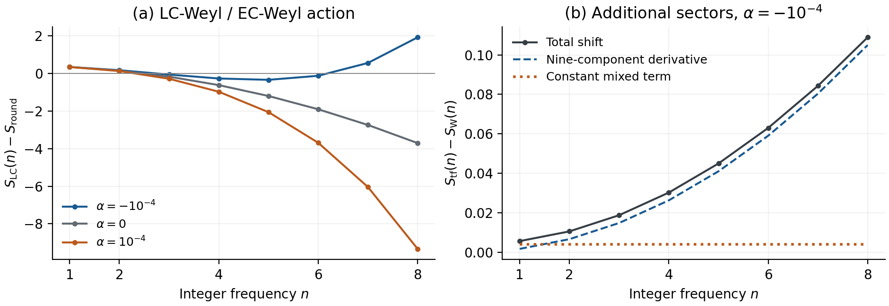

# 6. 周期的なshapeとtwistの連成

## 6.1 metric微分を含む曲率成分

$`S^3\times S^1`$ 上で $`r,L,\eta,V`$ を固定し、 $`h=\eta/r`$ 、torsion軸をframeの第3方向に整列させる。次のcoframeを使い、周波数系列にはPaper03の非退化な族(X4)を採用する。

式(J-01)。

$$
\begin{aligned}
e^0&=rf\sigma^0,\quad e^1=rf^{-1}\sigma^1,\quad e^2=r\sigma^2,
\quad e^3=L(\mathrm{d}y+w\sigma^0),\quad f=e^s,\\
w_n(y)&=A\cos(2\pi ny),\qquad
f_n^2=1-\frac{L^2w_n^2}{2r^2},\qquad
0\lt A\lt\frac{\sqrt2r}{L},\quad n\ge1.
\end{aligned}
$$

まず任意の滑らかな $`f(y)>0,w(y)`$ を許す。primeはy微分であり、第3節の物理円方向の微分とは区別する。coframeの一階・二階微分をCartan曲率に保持すると、次を得る。

式(J-02)。

$$
\begin{aligned}
W_{\mathrm{EC}}&=W_{\mathrm{LC}},\qquad
R_{\mathrm{EC}}-R_{\mathrm{LC}}=-6h^2-\frac23V^2,\qquad\mathcal N=0,\\
I_2&=\frac83h^2V^2+4h^2\left(\frac{(w')^2}{f^2r^2}+\frac{4(s')^2}{L^2}\right),
\qquad I_3=\frac83h^2V^2.
\end{aligned}
$$

torsion依存部分はmetric曲率全体を展開せずにも求まる。 $`(\sigma^0,\sigma^1,\sigma^2,\mathrm{d}y)`$ に対するcoframe行列を $`A^a{}_{\mu}`$ とし、 $`B=A^{-1}`$ 、 $`b_a=B^y{}_a`$ 、 $`D=A'B`$ と置く。構造テンソルには静的部分に加えて微分部分 $`(C_{\partial})^a{}_{bc}=D^a{}_c b_b-D^a{}_b b_c`$ が現れる。この族では $`b=(-w/(rf),0,0,1/L)`$ であり、Dの非零成分は $`D_{00}=s'`$ 、 $`D_{11}=-s'`$ 、 $`D_{30}=Lw'/(rf)`$ となる。contortionのframe成分は一定である。これらを式(G-04)と曲率式(B-02)へ代入すると、torsionによる差のWeyl射影は零となる。その微分部分は追加9成分に属し、静的な混合部分と直交し、ノルムは $`4h^2[(w')^2/(f^2r^2)+4(s')^2/L^2]`$ となる。4形式部分は一定である。完全NYを構成する両縮約はともに $`-4hV`$ で、式(J-02)の局所的な相殺を与える。

$`I_{\mathrm{tf}}-I_{\mathrm{LC}}`$ の定数項 $`16h^2V^2/3`$ はPaper02の静的結果である。変化する幾何からの追加寄与は式(J-02)の微分項であり、9成分部分だけが担う。

## 6.2 周波数多項式と四次係数の厳密な正値性

式(J-01)の係数関数を1を法とする基準位相nyで表す。構造係数と接続はnの一次、曲率は二次となる。位相反転に対して静的係数は偶、一階微分の係数は奇、二階微分の係数は偶であり、周期積分で奇数次が消える。次を定義する。

式(J-03)。

$$
\begin{aligned}
\mathcal R(n)&=\mathcal R_0+n\mathcal R_1+n^2\mathcal R_2,\\
\int_0^1 I_{\mathrm{LC}}(n)\thinspace \mathrm{d}y&=Q_0+Q_2n^2+Q_4n^4,
\qquad Q_4=\int_0^1\lVert\Pi_W\mathcal R_2\rVert^2\thinspace \mathrm{d}y,\\
D_A&=4h^2\int_0^1\left(\frac{(w_1')^2}{f_1^2r^2}
+\frac{4(s_1')^2}{L^2}\right)\mathrm{d}y.
\end{aligned}
$$

ここで $`\Pi_W`$ は付録AのWeyl射影である。式(J-03)の周波数係数 $`\mathcal R_2`$ は既約成分 $`R^{(2)}`$ と区別する。この係数は一定contortionに依存せず、LC Riemann曲率の対称性を持つため、三つの二乗不変量は同じ $`Q_4`$ を持つ。さらに、許された任意の固定非零振幅Aについて厳密に正となる。 $`y=1/4`$ では $`w_1=w_1''=s_1'=0`$ 、 $`s_1''=-L^2v^2/(2r^2)`$ となる。この点の $`\mathcal R_2`$ の独立な非零成分は $`(\mathcal R_2)_{0303}=(\mathcal R_2)_{1313}=-v^2/(2r^2)`$ のみであり、次が従う。

式(J-04)。

$$
\left.\lVert\Pi_W\mathcal R_2\rVert^2\right|_{y=1/4}
=\frac{v^4}{3r^4}=\frac{(2\pi A)^4}{3r^4}>0,
\qquad v=w_1'(1/4)=-2\pi A.
$$

$`Q_4`$ の被積分関数は非負かつ滑らかなので、式(J-04)から $`Q_4>0`$ が従う。これは選んだ振幅での数値確認に限られない。また $`D_A\ge0`$ であり、 $`h\ne0`$ なら厳密に正である。

$`\overline U_A`$ を曲率二乗項を含まない静的EC作用の経路平均とし、スカラー微分係数 $`C_A`$ はPaper03から継承する。整数 $`n\ge1`$ に対する積分作用は厳密に次となる。

式(J-05)。

$$
\begin{aligned}
S_{\mathrm{LC}}(n)=S_{\mathrm W}(n)
&=\overline U_A-C_A n^2-\alpha\mathcal V(Q_0+Q_2n^2+Q_4n^4),\\
S_{\mathrm{tf}}(n)-S_{\mathrm W}(n)
&=-\alpha\mathcal V\left(\frac{16}{3}h^2V^2+D_A n^2\right),\\
C_A&=\frac{\pi^2L^3}{16\kappa^2r}
\int_0^1\frac{w_1^2(w_1')^2}{f_1^4}\thinspace \mathrm{d}y>0,
\qquad\mathcal V=\frac{\pi^2Lr^3}{4}.
\end{aligned}
$$

固定した非零振幅では、三作用の最高次項は共通して $`-\alpha\mathcal VQ_4n^4`$ となる。正のαでは負の無限大、負のαでは正の無限大へ向かう。零結合ではPaper03の $`\overline U_A-C_A n^2\to-\infty`$ に戻る。したがって負の結合は、この固定振幅系列における高周波の下降を除く。この評価は振幅 $`A`$ を固定した整数周波数の系列についてのものである。

## 6.3 有限周波数での比較

$`r=3`$ 、 $`L=\kappa=\eta=V=1`$ 、 $`A=0.5`$ では、 $`Q_0=0.0003213884274`$ 、 $`Q_2=0.01228429824`$ 、 $`Q_4=0.2062093292`$ 、 $`D_A=0.2462621564`$ となる。スカラー部分は $`\overline U_A=-44.0019357894`$ 、 $`C_A=0.06430979322`$ であり、零結合でPaper03を再現する。

$`\alpha=-10^{-4}`$ では、この固定振幅系列の正整数周波数についての最小値は三作用とも $`n=5`$ にある。LC-Weylと既約EC-Weyl作用は −44.7490306345（round参照 −44.4132198049）、Ricciトレース除去作用は −44.7040679354（同モデルのround参照 −44.4092719631）となる。正の四次成長と、有限周波数で参照配置より低い作用を取ることは両立する。いずれも指定した族(J-01)に沿った作用の比較である。

式(J-01)の連成profile。 $`r=3`$ 、 $`L=\kappa=\eta=V=1`$ 、 $`A=0.5`$ 。左： $`\alpha=-10^{-4},0,10^{-4}`$ のLC-Weyl・既約EC-Weyl作用とround参照との差。右： $`\alpha=-10^{-4}`$ のRicciトレース除去作用の追加分を、既知の定数混合項と9成分の微分項へ分離。周波数は正整数である。
